<div align="center">

# ⚡ LinkedIn Indo Identity Mesh
### Professional Dossier, Perplexity Knowledge Terminal & Career Asset Automation
**Engineered by [PRAKHAR SHARMA](https://github.com/prak05) • [Interactive Portfolio](https://prak05.github.io/prak05/)**

<br/>

<a href="https://prak05.github.io/prak05/" target="_blank">
  
</a>
<a href="https://github.com/prak05/Linkedin-Indo">
  
</a>
<a href="mailto:prakharsx05@gmail.com">
  
</a>

<br/><br/>

<p align="center">
  
</p>

[](LICENSE)
[](#)
[](https://github.com/prak05)

</div>

---

### 💻 Active Node HUD & System Specification

```yaml
System Node    : Linkedin-Indo // Perplexity Knowledge Terminal
Domain         : Identity Systems, RAG Vector Search & Career Asset Automation
Vector Engine  : SQLite FTS5 (BM25) + Sublinear TF-IDF Vector Cosine Engine (22,995 chunks)
Cloud Agent    : Amazon Bedrock Agent Runtime (invoke_agent) + Cross-Region Claude 3.5/3.7
Core UI        : Perplexity Dark Terminal + Modern Light Mode Toggle
Preservation   : Dual-Branch Safety (Ex / main)
Lead Architect : Prakhar Sharma (RIET CSE '27 • Kerala, India)
```

---

## 🏛️ System Architecture Topology

```mermaid
flowchart LR
    A["Raw Profile & Local Workstation Data"] --> B["Multi-Source Ingestion & Chunking"]
    B --> C["SQLite FTS5 + TF-IDF Vector Cosine DB"]
    C --> D["Perplexity Hybrid Search Engine"]
    D --> E["RAG Fact Verification & AWS Bedrock Agent"]
    E --> F["Synchronized Career Package & Tailored Posts"]
    style A fill:#171717,stroke:#FF002D,stroke-width:2px,color:#F5F2F0
    style B fill:#252323,stroke:#FF002D,stroke-width:2px,color:#F5F2F0
    style C fill:#252323,stroke:#74121F,stroke-width:1px,color:#F5F2F0
    style D fill:#1b1b1b,stroke:#FF002D,stroke-width:2px,color:#F5F2F0
    style E fill:#1b1b1b,stroke:#FF002D,stroke-width:2px,color:#F5F2F0
    style F fill:#171717,stroke:#393434,stroke-width:1px,color:#F5F2F0
```



---

## ⚡ Core Capabilities & Bento Matrix

<table width="100%" border="0" cellspacing="0" cellpadding="8">
  <tr bgcolor="#252323">
    <th align="left" width="28%"><font color="#FF002D">SUBSYSTEM</font></th>
    <th align="left" width="52%"><font color="#F5F2F0">TECHNICAL ARCHITECTURE &amp; SPECIFICATION</font></th>
    <th align="center" width="20%"><font color="#FF002D">STATUS</font></th>
  </tr>
  <tr bgcolor="#1b1b1b">
    <td><b>Perplexity Vector RAG</b></td>
    <td>High-throughput SQLite FTS5 (BM25) + TF-IDF Vector Cosine index with <b>22,995 chunks</b> across PC data, KSERC, AWS, GitHub projects, and CVs. Sub-10ms retrieval.</td>
    <td align="center"><code><font color="#20B2AA">OPERATIONAL</font></code></td>
  </tr>
  <tr bgcolor="#202020">
    <td><b>AWS Bedrock Agent</b></td>
    <td>Native Amazon Bedrock Agent integration (<code>bedrock-agent-runtime.invoke_agent</code>) with cross-region inference support (Claude 3.5 Sonnet, Claude 3.7 Sonnet).</td>
    <td align="center"><code><font color="#FF002D">HARDENED</font></code></td>
  </tr>
  <tr bgcolor="#1b1b1b">
    <td><b>UI / Theme Engine</b></td>
    <td>Perplexity-inspired dark terminal interface with interactive knowledge explorer, citations, category pills, and an instant <b>Light Theme</b> toggle.</td>
    <td align="center"><code><font color="#20B2AA">DEPLOYED</font></code></td>
  </tr>
  <tr bgcolor="#202020">
    <td><b>Deterministic Dossier</b></td>
    <td>Single-Source-of-Truth profile, 1-page ATS resumes, tailored cover letter synthesis across technical and leadership tracks.</td>
    <td align="center"><code><font color="#FF002D">VERIFIED</font></code></td>
  </tr>
</table>

---

## ✦ Perplexity Knowledge Terminal & Vector DB

LinkedIn Indo includes an embedded, high-performance hybrid vector database (`knowledge.db`) powered by SQLite FTS5 full-text indexing and sublinear TF-IDF vector cosine similarity:

- **22,000+ Chunks Indexed**: Ingests master CV, resumes, KSERC records, AWS event recaps, project code repositories, and local markdown document archives.
- **Sub-10ms Hybrid Search**: Merges lexical BM25 matching and cosine vector similarity with category filtering, source citations, and exact quotes.
- **RAG-Enriched Drafting**: Automatically embeds verified personal facts into drafting prompts to eliminate hallucinations and adhere strictly to actual project experience.
- **Perplexity-style UI**: Dark terminal aesthetic by default with instant toggle to clean light mode, interactive Knowledge dialog, source badges, and snippet extraction.

---

## ☁️ Amazon Bedrock Agent Integration

Connect directly to AWS Bedrock Agents in Settings:
- Enter your AWS credentials or profile, along with **Bedrock Agent ID** and **Agent Alias ID**.
- Select the `Amazon Bedrock (Agent)` engine to converse with autonomous multi-agent workflows or route knowledge retrieval queries through AWS Bedrock.

---

## 📄 Cover Letters & ATS Resumes

LinkedIn Indo generates local-first, tailored cover letters from the persona and a pasted job description. The CLI and Web UI offer three tracks:
- `software_ai_cloud`
- `management_hr`
- `all_rounder`

### Canonical ATS resumes

The evidence-backed resume rebuild is generated with:

```sh
python3.13 tools/build_career_pdfs.py
```

It produces three stable, one-page PDFs and editable Markdown sources under `resumes/`:

- `ATS_Resume_Software_Engineering_Prakhar_Sharma.pdf`
- `ATS_Resume_AI_ML_Data_Prakhar_Sharma.pdf`
- `ATS_Resume_AWS_Cloud_Prakhar_Sharma.pdf`

---

## 🚀 Quickstart & Local Execution

Three ways to run the flow:

| Target | What runs | Drafts saved to |
|---|---|---|
| **MOCK** | `index.html` alone, with an in-browser stub (no network) | memory |
| **LOCAL** | `local_server.py` on this machine | `posts/*.md` |
| **CLOUD** | API Gateway HTTP API + Lambda + DynamoDB + Cognito (Terraform, Python 3.13 on arm64) | DynamoDB |

```bash
# Clone the repository with dual-branch mesh
git clone https://github.com/prak05/Linkedin-Indo.git
cd Linkedin-Indo

# Run local web terminal
python3.13 local_server.py

# Or launch CLI mode
python3.13 app.py
```

Open `http://localhost:8787/` in your browser.

---

## 🌐 Deploy to AWS

Connect with the automated wizard:

```sh
linkedin-indo-aws connect        # or: python3.13 aws_connect.py connect
```

Or deploy manually with Terraform:

```sh
cd infrastructure
terraform init
terraform plan -out=tfplan
terraform apply tfplan
```

Remove everything anytime with `terraform destroy`.

---

## 📡 API Reference

The same routes on both backends. On CLOUD, every route except `/health` requires a Cognito ID token in the `Authorization` header:

- `GET /health`: backend status
- `POST /drafts`: generate a draft (JSON: activity, topic, when, source, people; post_text for comments)
- `POST /drafts/revise`: revise a draft (JSON: history, feedback)
- `POST /posts`: save a draft (JSON: topic, when, draft)
- `GET /posts`: list drafts
- `POST /cover-letters`: generate a cover letter (JSON: track, job_title, company, job_description, location)
- `POST /cover-letters/revise`: revise a cover letter
- `POST /cover-letters/save`: save a generated cover letter

**LOCAL Only Endpoints:**
- `GET /rag/stats`: returns indexed chunk count and DB path
- `POST /rag/search`: hybrid search query (query, limit, category)
- `POST /rag/ingest`: triggers background vector re-ingestion
- `GET`/`POST /settings`: manage API keys, AWS credentials, Bedrock Agent ID & Alias
- `POST /settings/test`: test LLM or Bedrock connection
- `POST /settings/import-claude-code`: import credentials from Claude Code
- `POST /agent`: autonomous agent conversation step
- `GET /net`: internet connectivity status

---

## 🧪 Tests

```sh
python3.13 -m pytest tests/unit/
```

---

<div align="center">

<sub>Architected with extreme precision by <b>Prakhar Sharma</b> • Connected to <a href="https://prak05.github.io/prak05/"><font color="#FF002D">Live Portfolio</font></a> • Dual-Branch Mesh (Ex / main)</sub>

</div>
